<picture>
  
</picture>

 

  

---

Comunicóloga que abrió la consola para nunca cerrarla.

Hoy: **arquitectura hexagonal**, **edge deployments**, **Three.js**, pipelines con IA y scrollytelling que no querrás dejar de scrollear.

**Co-fundé [PineAipple](https://pineaipple.com.mx).** Trabajo en una de las empresas de comunicación más grandes de México. No he dejado de comunicar — solo cambié el canal.

---

---

### ↗ [PineAipple Web](https://pineaipple.com.mx)

Mascota 3D que se arma en tiempo real. Scrollytelling narrativo. Patrón de circuito generativo en GLSL.

`Three.js` · `Astro` · `Cloudflare` · `Python + Blender → GLSL`

---

  
  &nbsp;
  

  

---

&nbsp;

&nbsp;

